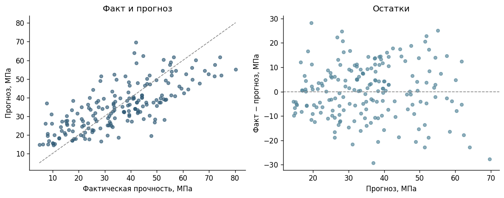
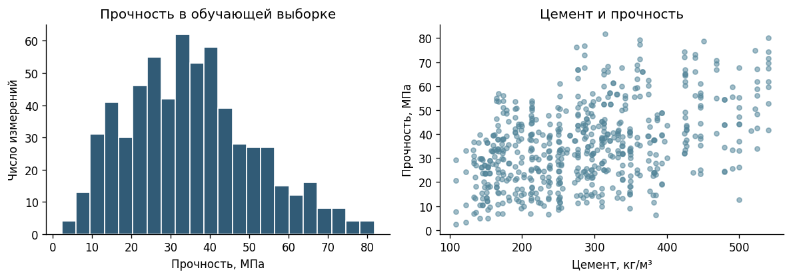

# Исследование градиентного бустинга для задачи регрессии

Практическая часть диплома «Прогнозирование непрерывной величины с использованием градиентного бустинга (XGBoost, LightGBM, CatBoost) и исследование влияния числа деревьев и глубины на переобучение».

**Работа в процессе.** Сейчас выполнен первый этап: подготовка данных, исследовательский анализ и базовая линейная регрессия. Эксперименты с бустингом ещё не проводились.

## Постановка начального эксперимента

Для старта выбран датасет [Concrete Compressive Strength из UCI](https://archive.ics.uci.edu/dataset/165/concrete+compressive+strength). По составу бетонной смеси и возрасту образца нужно предсказать прочность при сжатии в МПа. Целевая величина непрерывная; восемь признаков числовые.

Этот набор используется как рабочий пример для подготовки методики. Выбор данных и окончательный протокол экспериментов ещё можно уточнить в ходе диплома.

**Стек текущего этапа:** Python, pandas, NumPy, Matplotlib, scikit-learn. XGBoost, LightGBM и CatBoost пока не включены в зависимости.

## Что уже сделано

- Проверены пропуски, числовые значения и полные дубликаты.
- Из 1 030 строк удалены 25 полных дубликатов. Осталось 1 005 измерений.
- Зафиксировано разбиение на train, validation и test без пересечения одинаковых рецептур.
- Построены распределение прочности, график связи с количеством цемента и корреляции на train.
- Обучены предсказание среднего и линейная регрессия. Рассчитаны MAE, RMSE и R² на train и validation.
- Сохранены метрики, валидационные прогнозы и номера строк каждой части выборки.

## Разбиение данных

Одинаковая смесь может встречаться в разных возрастах. Такие записи объединены в группу по семи компонентам состава и не пересекаются между частями. Возраст остаётся признаком модели, но не входит в определение рецептуры.

| Часть | Измерения | Рецептуры | Назначение |
| --- | ---: | ---: | --- |
| Train | 623 | 256 | Обучение, подготовка признаков и EDA |
| Validation | 187 | 86 | Проверка базовой модели и будущий выбор параметров |
| Test | 195 | 86 | Финальная проверка после выбора модели |

Использован `GroupShuffleSplit`: сначала 20% групп отложены в test с seed 42, затем 25% оставшихся групп — в validation с seed 43. Доли групп примерно 60/20/20, доли строк отличаются. Назначение строк сохранено в `reports/split_assignment.csv`.

**На тестовой части метрики и предсказания ещё не считались.** Она будет использоваться в конце исследования.

## Первые результаты

| Модель | Часть | MAE, МПа | RMSE, МПа | R² |
| --- | --- | ---: | ---: | ---: |
| Среднее по train | Train | 13,09 | 16,25 | 0,000 |
| Среднее по train | Validation | 13,60 | 16,48 | −0,001 |
| Линейная регрессия | Train | 8,17 | 10,28 | 0,600 |
| Линейная регрессия | Validation | 8,89 | 11,00 | 0,554 |

На выбранной валидации линейная модель снижает RMSE на **33,3%** относительно предсказания среднего. Это результат одного фиксированного разбиения, а не доказательство устойчивого преимущества на любых данных.



Ошибка на validation выше, чем на train, но по одному такому сравнению нельзя сделать вывод о сильном переобучении. На графике остаются заметные ошибки, в том числе недооценка части высоких значений прочности. Базовая модель нужна как ориентир для будущих экспериментов с нелинейными моделями.



На train самая высокая положительная парная корреляция с прочностью среди исходных признаков — у количества цемента: около 0,45. Корреляция не является причинной оценкой или показателем важности признака в будущей модели.

## Ограничения текущего этапа

Полные дубликаты удалены как повторные записи; идентификаторов испытаний нет, поэтому нельзя полностью исключить, что это независимые измерения. Группы определены по точному совпадению состава: близкие рецептуры могут оказаться в разных частях. Проверка относится к новым точным рецептурам из того же набора, а не к любым материалам и условиям.

Разбиение фиксированное, кросс-валидация пока не проведена. Нелинейные признаки, подбор параметров и бустинг ещё не исследовались. Результатов о влиянии глубины и числа деревьев в этой версии нет.

## Что дальше

Черновой план в [PLAN.md](PLAN.md): обучить три реализации бустинга, построить кривые ошибок при изменении числа деревьев и глубины, проверить устойчивость результатов и затем оценить выбранную модель на отложенном тесте.

## Запуск

Проверено на Python 3.13 и scikit-learn 1.6.1. Для установки используйте Python 3.11–3.13. Данные уже включены, скачивать их для запуска не нужно.

Из корня проекта в Windows PowerShell:

```powershell
python -m venv .venv
.venv\Scripts\python.exe -m pip install -r requirements.txt
.venv\Scripts\python.exe -m ipykernel install --user --name diploma-baseline --display-name "Python (diploma-baseline)"
.venv\Scripts\python.exe -m notebook 01_data_and_baseline.ipynb
```

В Linux/macOS вместо `.venv\Scripts\python.exe` используйте `.venv/bin/python`.

В Jupyter выберите ядро **Python (diploma-baseline)** и выполните **Restart Kernel and Run All Cells**. Ячейки пересоздают результаты в `reports/`. В ноутбуке уже сохранены таблицы и графики для просмотра на GitHub.

## Состав репозитория

```text
01_data_and_baseline.ipynb   выполненный первый этап
data/concrete.csv           исходные числовые данные с короткими названиями колонок
data/source.json            происхождение, соответствие колонок и SHA-256
data/UCI_Readme.txt         описание от автора данных
reports/                   разбиение, метрики, прогнозы и графики
PLAN.md                    ещё не выполненные этапы
requirements.txt           зависимости текущей версии
```

Источник: Yeh, I. (1998). *Concrete Compressive Strength*. UCI Machine Learning Repository, [DOI: 10.24432/C5PK67](https://doi.org/10.24432/C5PK67). Данные распространяются по [CC BY 4.0](https://creativecommons.org/licenses/by/4.0/). При подготовке CSV изменены только формат файла и названия колонок; очистка выполняется в ноутбуке.
